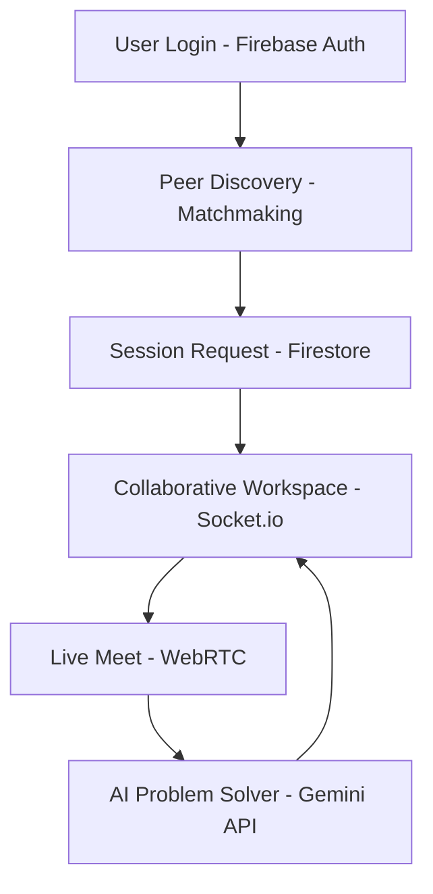

# Slide: Technical Approach - Technologies Used

## 1. Core Technologies
*   **Programming Language:** TypeScript (for type safety and maintainability)
*   **Frontend Framework:** React 19 (Functional components, Hooks)
*   **Build Tool:** Vite 6 (Fast HMR and optimized production builds)
*   **Styling:** Tailwind CSS 4 (Utility-first CSS for rapid, responsive UI design)

## 2. Backend & Real-time
*   **Server:** Node.js with Express (API routing and static file serving)
*   **Real-time Communication:** Socket.io (WebSockets for signaling and presence)
*   **Video/Audio:** WebRTC (Peer-to-peer streaming for Live Meets)
*   **State Management:** Zustand (Lightweight, scalable client-side state)

## 3. Infrastructure & AI
*   **Database & Auth:** Firebase (Firestore for NoSQL data, Firebase Auth for secure login)
*   **AI Engine:** Local LLM (Ollama) via ngrok tunnel (Multimodal analysis for AI Problem Solver)
*   **Canvas/Whiteboard:** Konva & React-Konva (High-performance 2D canvas rendering)

---

# Slide: Technical Approach - Methodology & Process

## 1. Implementation Methodology
*   **Agile Development:** Iterative sprints focusing on core features (Matchmaking -> Sessions -> Live Meets).
*   **Component-Driven Design:** Reusable UI components (Buttons, Modals, Layouts) to ensure consistency.
*   **Real-time Synchronization:** Server-authoritative state for collaborative tools (Whiteboard, Notes).

## 2. System Architecture Flow

1.  **Authentication:** User logs in via Firebase Auth (Google).
2.  **Matchmaking:** AI-driven search queries Firestore to find peers with matching skills.
3.  **Session Lifecycle:**
    *   Request -> Accept (Firestore update)
    *   Workspace initialization (Socket.io connection)
    *   Real-time collaboration (Whiteboard/Notes sync)
4.  **Live Meet:**
    *   Signaling via Socket.io
    *   P2P Video/Audio via WebRTC
    *   AI Analysis: Gemini API processes video frames for problem-solving.

## 3. Working Prototype Status
*   **Functional Features:** Real-time chat, collaborative whiteboard, peer matchmaking, and AI-powered video problem solver.
*   **Data Persistence:** All user profiles, sessions, and messages are persisted in Firestore.
*   **Responsive Design:** Fully optimized for Mobile and Desktop environments.
